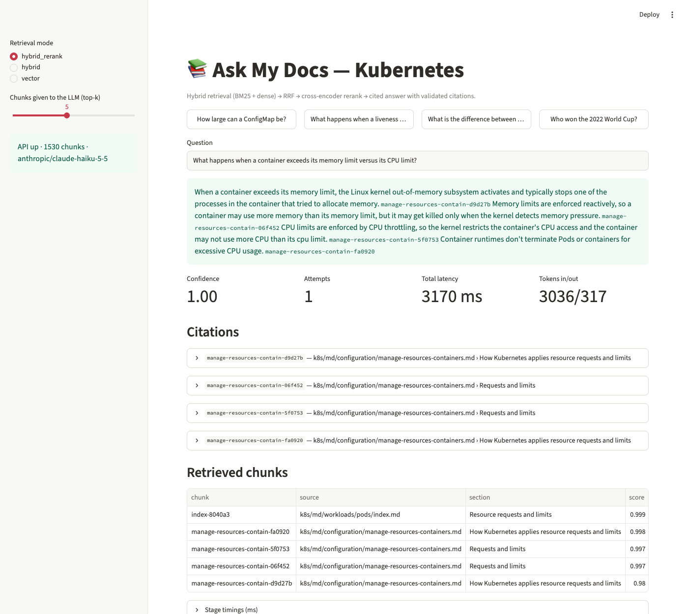
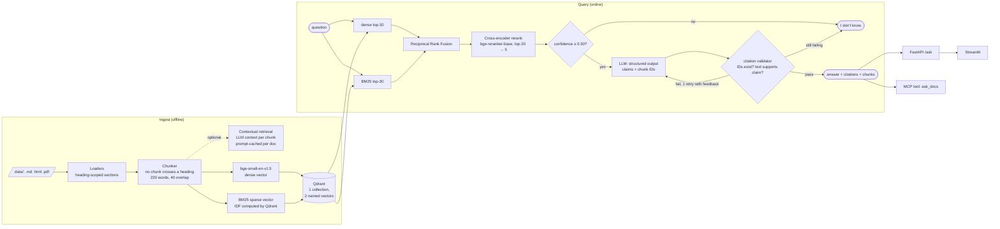

# Ask My Docs — production-style RAG with enforced citations

[](https://github.com/siri-dhillon/ask-my-docs/actions/workflows/ci.yml)

Ask questions about the Kubernetes documentation and get answers where **every sentence cites the
doc chunk it came from**. Those citations are **checked after generation**: if they don't hold up,
the system retries once and then says *"I don't know"*. Retrieval quality and answer quality are
measured on a golden dataset, and **CI fails any PR that makes them worse**.

> Portfolio project 1 of 5, based on the project list in
> **["5 AI Engineer Projects to Build in 2026 | Ex-Google, Microsoft" by Aishwarya Srinivasan](https://www.youtube.com/watch?v=9WIsvEswZTk)**.
> The project ideas come from her video. The implementation, the extra features (contextual retrieval,
> structured-output citations, MCP server, passage-level eval) and any mistakes are mine.



## What it does

Real output (retrieval stage) for *"How many times will a Job retry failed pods by default?"*:

| rank | chunk | section | rerank prob | dense rank | BM25 rank |
|---|---|---|---|---|---|
| 1 | `job-34a248` | Handling Pod and container failures › Pod backoff failure policy | 0.982 | 1 | 2 |
| 2 | `job-1686af` | Job termination and cleanup | 0.934 | 7 | 1 |
| 3 | `job-4e7c05` | Handling Pod and container failures › Pod failure policy | 0.749 | 3 | 5 |

The LLM then answers in claims that each cite one of these IDs. Off-topic questions never reach the LLM:

```
$ askdocs ask "Who won the 2022 World Cup?"
I don't know. The documentation I have doesn't clearly answer that.
confidence=0.00 attempts=0
```

## Architecture



## Results

The eval set is 45 answerable questions and 6 out-of-scope ones, written against the corpus
([`eval/golden.jsonl`](eval/golden.jsonl)). Every answerable question has an evidence phrase, and a
unit test checks that phrase really appears in the gold source.

**Retrieval, measured at passage level.** A hit only counts if the retrieved chunk contains the
answer evidence, not just if it comes from the right page. (Measured at page level, every mode
scores 1.00 at k=5, which tells you nothing.)

| Mode | Recall@1 | Recall@3 | Recall@5 | Recall@10 | MRR@10 | p50 latency |
|---|---|---|---|---|---|---|
| Vector only (bge-small) | 0.533 | 0.822 | 0.844 | 0.956 | 0.692 | 3 ms |
| Hybrid (BM25 + dense, RRF) | 0.533 | 0.844 | 0.867 | 0.978 | 0.707 | 14 ms |
| **Hybrid + rerank (bge-reranker-base)** | **0.667** | **0.933** | **0.956** | **1.000** | **0.803** | 1.2 s (CPU) |

Measured on an Apple M5 Pro CPU (ONNX Runtime). `top_k=5` chunks go to the LLM, so **Recall@5 is the
number that matters most**. Reranking moves it from 0.87 to 0.96.

**Reranker sweep** (hybrid + rerank, passage level):

| Reranker | Pool | Recall@1 | Recall@5 | MRR@10 | p50 |
|---|---|---|---|---|---|
| ms-marco-MiniLM-L-6-v2 | 10 | 0.600 | 0.911 | 0.757 | 0.12 s |
| ms-marco-MiniLM-L-6-v2 | 30 | 0.600 | 0.911 | 0.754 | 0.35 s |
| **bge-reranker-base** | **20** | **0.667** | **0.956** | **0.803** | 1.1 s |
| bge-reranker-base | 30 | 0.667 | 0.956 | 0.803 | 2.1 s |

**Confidence gate** (refusal before any LLM call): 5 of 6 out-of-scope questions are refused at
reranker probability < 0.30, and none of the 45 answerable ones are. The lowest-scoring answerable
question scores 0.67. The LLM's own `answerable` flag handles the remaining out-of-scope question.

**End-to-end answer quality.** All 51 questions are answered by `claude-haiku-5-5` and scored by an LLM judge:

| Faithfulness | Citation accuracy | Relevance | Correctness | Answer rate | Out-of-scope refused | Retry rate | p50 | p95 | Cost / query |
|---|---|---|---|---|---|---|---|---|---|
| 1.000 | 0.989 | 0.989 | 0.983 | 1.000 (45/45) | 1.000 (6/6) | 2% | 2.9 s | 4.1 s | **$0.00034** |

- *Faithfulness*: the share of claims supported by any retrieved chunk.
- *Citation accuracy*: the share supported by the specific chunks the claim cites.
- *Relevance* and *correctness*: 1–5 ratings rescaled to 0–1, with correctness judged against the reference answer.
- *Cost*: answer generation only. The judge added about $0.015 for the whole run.

### What worked, what didn't (failure cases)

- **The lexical citation check is too lenient.** Two answers (q19 pod phases, q36 finalizers) passed the in-pipeline
  check, but the judge found one claim in each citing a chunk that didn't support it. The claim was
  true, but it was backed by a *different* retrieved chunk. Word overlap can't tell those apart.
  `ASKDOCS_CITATION_CHECK=llm` closes the gap, at the cost of one extra LLM call per answer.
- **Some answers are correct but incomplete** (correctness 0.75). For example, q11 ("how do I declare a sidecar?")
  was right but vague. The passage that actually explains the container-level `restartPolicy` field was ranked
  **#1 by plain hybrid search but demoted to #7 by the reranker**, so it never reached the LLM (top 5).
  Rerankers win on average (+9 pts recall@5 here) but can lose individual queries. Possible mitigations
  are fusing the reranker score with the RRF rank instead of replacing it, or a larger top_k.
- **The retry loop did its job once.** q22's first draft failed validation, and the retry with
  validator feedback produced a valid, cited answer.
- **Refusals are split across the two layers as designed.** 5 of 6 out-of-scope questions were refused by the
  confidence gate (no LLM tokens spent). The 6th, about the CNCF donation year, retrieved on-topic
  Kubernetes chunks with 0.56 confidence, and the LLM itself set `answerable=false`.
- **Caveat: Haiku is judging Haiku.** Models tend to rate their own outputs favourably, so these scores are
  probably optimistic. A stronger or different judge (`--judge-model claude-sonnet-5-5`) is the next step
  toward trustworthy numbers. The 0.30 confidence threshold was also tuned on this same set.

## Design decisions and tradeoffs

- **Chunking along document structure, not fixed-size.** A chunk never spans two headings, so each one stays on one
  topic and carries a breadcrumb (`ConfigMaps > Using ConfigMaps > Immutable ConfigMaps`) that gets
  embedded with it. This is cheap, free contextual retrieval. Sections under 25 words are merged into
  the next one, so the index doesn't fill with fragments.
- **One Qdrant collection with two named vectors.** The dense and BM25 vectors live on the same point, so
  there's one write path and no risk of the two indexes drifting apart. Qdrant applies the IDF
  modifier server-side, so BM25 stays correct as documents are added. Local development uses
  Qdrant's embedded mode (no Docker); `docker-compose` runs the real server.
- **RRF instead of adding scores together.** BM25 scores are unbounded and cosine scores aren't, so the two
  can't be added. RRF only looks at ranks and has a single constant (k=60). On this corpus, hybrid
  search alone helps a little (+2 pts R@5). The real gain is that it **puts more relevant passages in
  front of the reranker**.
- **Reranking is where the quality comes from, and also the latency.** The cross-encoder reads the question and
  chunk together, which is far more accurate than comparing two embeddings. It's the slowest stage
  on CPU (about 1.1 s). In production I'd move it to a GPU (single-digit ms) or use MiniLM with a pool
  of 10 (0.12 s, −4.5 pts R@5). Batch size 8 instead of 64 cut CPU time by ~40%, because each batch is
  padded to its longest pair.
- **Citations as structured output, not regex.** The LLM returns `{answerable, claims: [{text, chunk_ids}]}`
  through constrained decoding (`messages.parse` with a Pydantic model), so the output can't come back
  malformed. Claude's native Citations API was an alternative, but it can't be combined with
  structured outputs, and per-claim chunk IDs make the validator straightforward.
- **The validator is a hard gate.** It checks three things: every claim has a citation, every cited ID
  was actually retrieved (this catches hallucinated IDs), and the cited text supports the claim. The
  support check is lexical overlap by default (free) or an LLM judge (`ASKDOCS_CITATION_CHECK=llm`).
  On failure it retries once with the validator's feedback, then answers "I don't know". A partial
  answer would be more helpful, but a wrong answer with a citation attached is worse than no answer.
- **Two layers of refusal.** A retrieval-confidence gate refuses without spending LLM tokens. The LLM's
  `answerable=false` catches questions that look on-topic but aren't answered by the docs. The 0.30
  threshold was **calibrated on the eval set**, so it is optimistic. A held-out set would be the honest
  next step.
- **Eval at passage level, not page level.** Page-level recall was 1.0 for every mode and couldn't tell them
  apart. Requiring the evidence text to be inside the retrieved chunk is stricter and closer to what
  the LLM actually needs.
- **Custom LLM judge instead of Ragas.** One structured judge call per answer returns per-claim support
  (against the whole context, and against only the cited chunks) plus 1–5 relevance and correctness
  ratings. That's fewer dependencies and calls than Ragas, and every judgement can be inspected in the JSON
  report. The tradeoff is that the metrics aren't Ragas-standard.
- **The LLM provider is pluggable.** `anthropic` (default `claude-haiku-5-5`, low effort, since this is grounded
  extraction), `openai`, `ollama` (localhost, fully offline) or `fake`. The `fake` provider is
  deterministic and lets tests and CI run without secrets.
- **Contextual retrieval is opt-in** (`askdocs ingest --contextualize`). For each chunk, an LLM writes one
  or two sentences placing it within its document. The whole document sits in a **prompt-cached**
  system block, so every chunk after the first reads it from cache. The output is cached on disk by chunk ID.

## Up-to-date techniques beyond the original brief

| Addition | Why it matters in 2026 |
|---|---|
| Contextual retrieval with prompt caching | Fewer retrieval failures on chunks that make no sense out of context, at a fraction of the token cost |
| Structured outputs for citations | Valid JSON is guaranteed, so there's no parsing code to fail |
| MCP server (`askdocs-mcp`) | Agents such as Claude Code, Claude Desktop and IDE assistants can query the docs as a tool |
| Keyless auth: `ant` login locally, OIDC Workload Identity Federation in CI | No long-lived API key anywhere: nothing to leak, nothing to rotate |
| Passage-level eval + dataset integrity test | Metrics that can actually tell the retrieval modes apart, on gold labels that are verified |
| `uv` + `ruff` + embedded Qdrant | Fast, reproducible setup; no Docker needed for local development |

## Quickstart

```bash
uv sync --all-extras
ant auth login                    # or put ANTHROPIC_API_KEY in .env, or set ASKDOCS_LLM_PROVIDER=ollama
uv run askdocs ingest             # ~90 s on a laptop CPU: 110 docs -> 1,530 chunks
uv run askdocs ask "What is a PodDisruptionBudget?"
uv run uvicorn askdocs.api.app:app --reload        # POST /ask, GET /health
uv run streamlit run ui/streamlit_app.py           # UI on :8501
```

Or run everything (Qdrant server, ingest job, API, UI) with one command: `docker compose up --build`.

**Use it from Claude Code:** `claude mcp add ask-my-docs -- uv --directory $(pwd) run askdocs-mcp`

**API**

```bash
curl -s localhost:8000/ask -H 'content-type: application/json' \
  -d '{"question": "How large can a ConfigMap be?", "mode": "hybrid_rerank", "top_k": 5}'
```

The response contains `answer`, `claims[]` (each with its `citations` and a `supported` flag),
`citations[]` (with source, section and quote), `retrieved[]` (with dense and BM25 ranks and scores),
`confidence`, `refused`/`refusal_reason`, `timings_ms` per stage, and token `usage`.

## Evaluation and the CI gate

```bash
uv run python eval/run_eval.py --retrieval-only --check eval/eval_thresholds.yaml   # free
uv run python eval/run_eval.py --check eval/eval_thresholds.yaml                    # + LLM judge
```

On every PR, [`ci.yml`](.github/workflows/ci.yml) runs lint, the unit tests (no network LLM calls),
builds the index and runs the eval. The build fails if any metric drops below its minimum in
`eval_thresholds.yaml`, or a bounded metric goes above its maximum (for example, a false-refusal rate
above 5%). Once Workload Identity Federation is configured, the answer-quality metrics are gated too.

**CI has no API key to leak.** The eval job authenticates to the Claude API with **Workload Identity Federation**:
GitHub issues a short-lived OIDC token for this repository's workflow, and Anthropic exchanges it for a
10-minute access token. The only repo settings are non-secret IDs (`ANTHROPIC_FEDERATION_RULE_ID`,
`ANTHROPIC_ORGANIZATION_ID`, `ANTHROPIC_SERVICE_ACCOUNT_ID`, stored as repo *variables*). The rule is pinned to
`repo:siri-dhillon/ask-my-docs:`, so other repos and forks can't use it. Because GitHub's tokens only
live about 5 minutes and the eval takes longer, the job refreshes the token file in the background.
Locally, `ant auth login` does the same job: the SDK picks up the signed-in profile, and no key sits in `.env`.
The results table goes in the job summary and the JSON report is uploaded as an artifact.

## Repo layout

```
src/askdocs/
  ingest/      loaders.py (md/html/pdf), chunker.py, contextualize.py
  index.py     Qdrant: dense + BM25 named vectors
  retrieve/    fusion.py (RRF), rerank.py (cross-encoder), pipeline.py (3 modes + confidence)
  generate/    providers.py, schemas.py, answer.py (draft→validate→retry), citations.py
  api/app.py   FastAPI      mcp_server.py   MCP tool      service.py   wiring      cli.py
ui/            Streamlit page
eval/          golden.jsonl, metrics.py, run_eval.py, eval_thresholds.yaml, reports/
scripts/       fetch_corpus.py (rebuilds the corpus from a pinned upstream commit)
tests/         ingestion, retrieval, generation, API, golden-set integrity
```

## Corpus and credits

- Project brief: Aishwarya Srinivasan, ["5 AI Engineer Projects to Build in 2026"](https://www.youtube.com/watch?v=9WIsvEswZTk).
- Corpus: a slice of the [Kubernetes documentation](https://github.com/kubernetes/website) © The Kubernetes Authors,
  [CC BY 4.0](https://creativecommons.org/licenses/by/4.0/). See [`data/k8s/ATTRIBUTION.md`](data/k8s/ATTRIBUTION.md).
- RRF: Cormack, Clarke and Büttcher, *Reciprocal Rank Fusion outperforms Condorcet and individual Rank Learning Methods*, SIGIR 2009.
- Contextual retrieval: Anthropic, *Introducing Contextual Retrieval* (2024).
- Models: BAAI bge-small-en-v1.5 and bge-reranker-base, run through [fastembed](https://github.com/qdrant/fastembed).

Code is MIT licensed.
